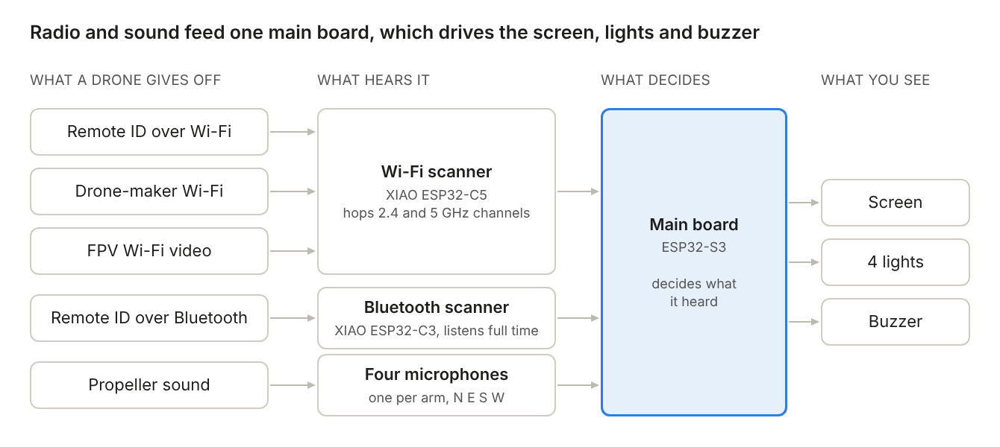
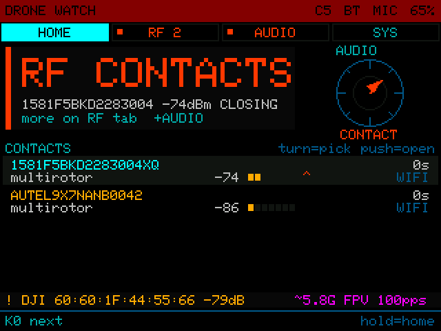
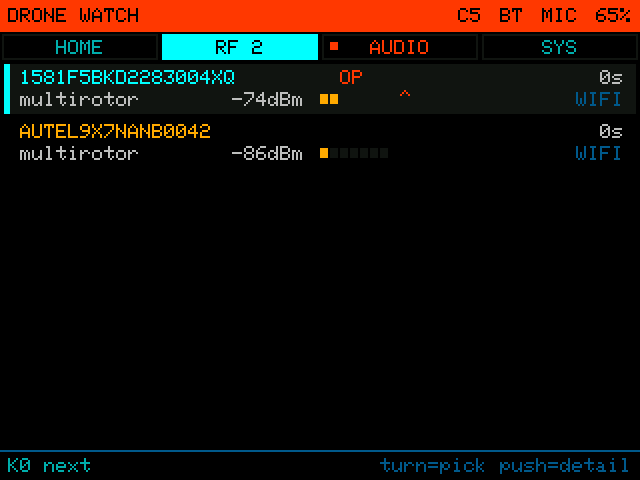
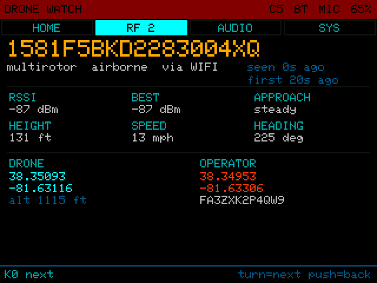
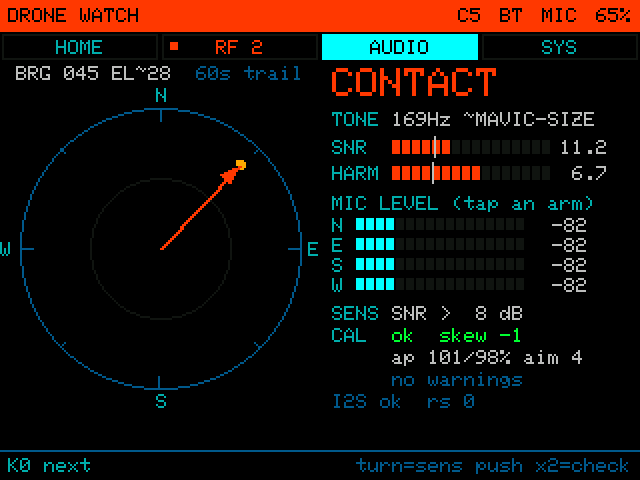
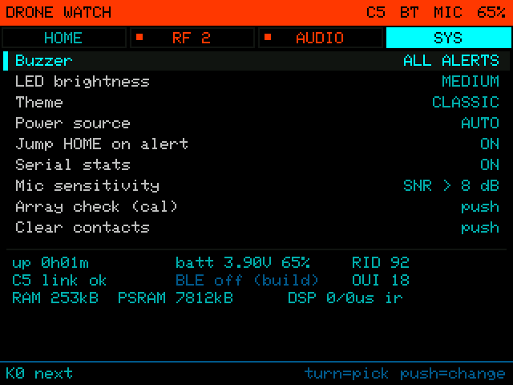

# DRONE WATCH User Guide

Last updated November 21, 2026. Try the device in your browser: [DRONE WATCH field simulator](https://pkkshadow.github.io/drone-watch-demo/). The simulator runs the November 4 firmware, so it doesn't have the Bluetooth board or network-name hints described below yet.

## What DRONE WATCH is

DRONE WATCH is a small box that tells you when a drone is nearby, by listening. It never sends anything at a drone, and it can't control, jam or harm one. It only receives what is already in the air.

It listens in two ways:

- **Radio.** Most new drones must broadcast a digital "license plate" called Remote ID, over Wi-Fi or Bluetooth. DRONE WATCH picks up both and shows the drone's ID, its position and height, and where its pilot is standing. It also notices radio signals and Wi-Fi network names that only drones use, and the kind of Wi-Fi video link some FPV racing drones use.
- **Sound.** Four small microphones on a cross-shaped arm hear the buzz that propellers make. The device tells a drone's buzz apart from other noises and points to which direction it is coming from.

You don't need to know anything about drones to use it. Set it up outside, switch it on, and watch the screen and the lights. A beep tells you when something new shows up.

## Drones 101, for people who have never flown one

A drone is a small flying machine, usually with four propellers, steered by a pilot on the ground holding a controller. These are the kinds you are likely to meet:

| Kind | What it looks and sounds like | How DRONE WATCH notices it |
| --- | --- | --- |
| Camera drone (DJI Mavic, Mini, Air; Autel) | Grey or white, 0.5 to 2 lb, hovers steadily for photos. A steady, mid-pitched hum. | Remote ID by radio (Wi-Fi or Bluetooth), plus sound |
| Older or budget camera drone | Often connects to a phone over Wi-Fi. | Its maker's Wi-Fi signal or network name (a hint), plus sound |
| FPV racing or freestyle drone | Small and very fast, flown through video goggles. A high-pitched whine that changes pitch quickly. | Sound; a Wi-Fi video link if it uses one |
| Large drone (crop spraying, film, delivery) | Big, often six or eight propellers. A deep, low drone. | Remote ID by radio, plus sound |

A few facts make the screens easier to read:

- **Remote ID is a legal requirement.** In the US, any drone that has to be registered with the FAA must broadcast Remote ID. The FAA has enforced this fully since March 16, 2024 ([source](https://www.thedroneu.com/blog/remote-id/)). Hobby drones that weigh 250 g or less don't have to, so a small drone with no Remote ID is not necessarily breaking a rule.
- **What Remote ID contains:** the drone's ID number, its position and height, its speed and direction, and where the pilot is. Add-on Remote ID modules report the takeoff spot instead of the pilot.
- **Height:** most drone flights in the US stay below 400 feet.
- **Sound:** a drone's hum comes from the propeller blades passing hundreds of times a second. Big drones hum low (around 100 Hz), small fast ones whine high (400 Hz and up). DRONE WATCH uses this pitch to guess the size.
- **FPV** means first-person view. The pilot wears goggles showing live video from the drone, usually sent on the 5.8 GHz band.

## How it works

Three small computers inside the box share the work:

- a Wi-Fi scanner (the XIAO ESP32-C5);
- a Bluetooth scanner (the XIAO ESP32-C3);
- the main board (the ESP32-S3), which listens to the microphones and runs the screen, lights and buzzer.

The radio signals go to the two scanners; propeller sound goes to the microphones. The main board combines all three and decides what to show.

### The radio side

The Wi-Fi scanner hops between Wi-Fi channels every eighth of a second. Channel 6 gets every other turn, because Remote ID usually lives there, and a short visit to the 5 GHz band is part of each round. It reports four kinds of find to the main board:

- **Remote ID in Wi-Fi beacons.** This is the most common kind on DJI drones.
- **Remote ID over Wi-Fi "NAN".** A second Wi-Fi method some drones and add-on modules use. The device joins the pieces of each drone's messages into one contact.
- **Drone-maker radios.** Every Wi-Fi device has a hardware address, and the first half of the address names the maker. The list covers DJI, Autel, Yuneec, FIMI, Hubsan, Zero Zero and others, checked against the official IEEE registry. The scanner also reads the Wi-Fi network name, so a drone with a random or generic address still matches by its name. Either one, with no Remote ID, becomes a hint, not a contact.
- **5.8 GHz video-style traffic.** A lot of Wi-Fi traffic that doesn't belong to any nearby router suggests an FPV video link. This is also a hint.

Each drone's signal strength is shown in dBm. Numbers closer to zero are stronger: about −40 is very close, and −90 is barely heard. When the strength keeps rising over several seconds, the drone is marked CLOSING.

A second scanner, the XIAO ESP32-C3, listens for Remote ID over Bluetooth the whole time. It hears ordinary Bluetooth 4 broadcasts, and Bluetooth 5 Long Range ones when it is built with that option. It passes each drone to the main board the same way the Wi-Fi scanner does, so one drone heard both ways shows up as one contact marked W+B.

### The sound side

Four microphones sit 11 cm from the center, one on each arm: North, East, South and West. Every 21 thousandths of a second, the main board looks at the sound between 100 and 4,000 Hz and asks two questions:

1. **Does it sound like a propeller?** A propeller makes a stack of evenly spaced tones, like a musical note with overtones. The screen calls this score HARM.
2. **Is it louder than the usual background?** The device keeps a running idea of how loud "normal" is. The screen calls the difference SNR. A noise that stays steady, like an air conditioner, slowly becomes the new normal and stops counting.

When both scores stay above their lines for about half a second, the device declares an ACOUSTIC CONTACT. Sound reaches the nearest microphone a fraction of a millisecond before the others. From those tiny delays it works out the direction, as a compass bearing from north, and a rough angle up from the horizon.

## Setting it up outdoors

Set it up in the open, point the North arm at north, and switch it on before any drone arrives. The details:

1. **Charge it first.** Plug USB-C into the charger port with the power switch OFF. Never plug a USB cable into the S3 or C5 boards while the switch is ON, because two power sources would fight.
2. **Put up the mast.** The microphone cross goes on top of the 3-foot wooden mast, level with the ground. Higher is better: it puts the mics above people talking and away from ground noise.
3. **Point the N arm north.** Use a phone compass, set to true north if it offers that. The direction readings are measured from this arm, so if it points 20° off, every bearing is 20° off.
4. **Pick a quiet, open spot.** Stay away from air conditioners, generators, idling engines, busy roads and running water. Each of these hums or rumbles in the drone range. Shelter the mics from wind if you can; foam windscreens help a lot.
5. **Keep metal off the top of the box.** The main board's antenna sits at the top edge and needs about half an inch of clear space with no metal over it.
6. **Switch on, then wait a minute.** The screen shows the boot screen, then HOME. The microphones start after about 4 seconds, and the background level needs about a minute to settle.
7. **Run the array check** (next section) the first time, and again after anything on the mic cross is moved or rewired.

Power on before drones show up. If a drone is already hovering nearby when you switch on, the microphones may learn its hum as part of the normal background and not report it.

## The array check (calibration)

The array check takes about two minutes and teaches the device the exact shape and timing of your microphone cross. You need a quiet moment and your hands.

1. Press K0 until the **AUDIO** tab is lit.
2. Push the encoder knob once. The screen says PUSH AGAIN. Push it again within 3 seconds.
3. The screen shows **SNAP N 1/3**, and an orange dot marks the North arm on the compass.
4. Stand so your hands are about 1 m (3 ft) out from the center, in line with that arm and level with the microphones. Snap your fingers or clap once, sharply.
5. A short chirp means it heard you. Wait a moment, then snap again. Do three snaps per arm.
6. A higher beep means that arm is done. The dot moves on: North, then East, South, West.
7. At the end, a long high tone means it passed. A long low tone means it failed (see below).

You have about 20 seconds per arm before it gives up. To stop early, push the knob once.

**Reading the result** (shown on AUDIO next to CAL):

| Screen says | What it means | What to do |
| --- | --- | --- |
| ok skew −1 | Passed. The two microphone channels are one sample apart, and that is now corrected. | Nothing; it is saved. |
| ap 101/98% | The measured size of each axis compared with the design (11 cm arms). 85% to 115% is normal. | Nothing |
| no warnings | Every snap agreed. | Nothing |
| check: snaps not level | An axis measured more than 15% off. | Redo with your hands level with the mics. |
| check: skews disagree / noisy snaps | The snaps didn't agree with each other. | Redo somewhere quieter, with sharper snaps. |
| no snap at E | It timed out waiting at that arm. | Snap louder, or closer to that arm. |
| wiring is off, MAP {…} | The mics aren't where the firmware expects them. | Do the tap test: tap each mic gently and watch which MIC LEVEL bar jumps. |
| redo: I2S restarted | The audio stream restarted, so the saved timing may be stale. | Run the check again. |

The result is saved and survives a reboot. Typing `k` on the USB serial port prints the full report.

## The controls

There are only two controls: the K0 button and the encoder knob, which you turn and also push like a button. "Hold" means pressing for more than about half a second.

| Action | HOME | RF | AUDIO | SYS |
| --- | --- | --- | --- | --- |
| K0 press | next screen | next screen | next screen | next screen |
| K0 hold | back to HOME, following the newest contact | same | same | same |
| Turn the knob | pick a contact | pick a contact | change sensitivity | pick a setting |
| Push the knob | open the picked contact's details | open or close details | push twice to start the array check, once to stop it | change the setting |
| Hold the knob | back to HOME | details back to the list | back to HOME | back to HOME |

When a new alert comes in, the screen jumps to HOME by itself, unless you have used the controls in the last 10 seconds. You can turn this off in SYS (Jump HOME on alert).

## Reading the screens

There are four screens, shown as tabs under the top bar: HOME, RF, AUDIO and SYS. HOME answers the only question that matters most of the time: is anything out there? The screenshots below come from the simulator, in the CLASSIC theme.

**The top bar** reads DRONE WATCH on the left. On the right are four status words:

- **C5** is green while the radio scanner is talking to the main board, and red if it has gone silent.
- **BT** is green while the Bluetooth scanner is talking to the main board, and red if it has gone silent.
- **MIC** is green when the microphones are running.
- **Battery percent** is shown on the far right, or USB when plugged in.

The whole bar flashes red while there is an alert. A small red square on a tab means something is happening on that screen.

### HOME

- **The big card** says CLEAR (green), ACOUSTIC (amber, heard but no radio), RF HINT (purple, a drone-maker radio or FPV video, no Remote ID) or RF CONTACT (red, a drone broadcasting Remote ID). The line under it gives the newest contact's ID and signal strength, and CLOSING if it is getting nearer.
- **The small compass** on the right, labelled AUDIO, shows the direction of a sound the microphones think is a drone.
- **CONTACTS** lists up to four drones, newest first: ID, type, signal strength with a bar, ^ if closing, how long ago it was last heard, and WIFI or BLE.
- **The bottom strip** shows hints: ! DJI followed by a network name (or a hardware address) means a drone-maker radio, and \~5.8G FPV means video-like traffic.

### RF list

Every drone heard by radio in the last 15 minutes, up to seven on screen. When there are no Remote ID contacts but there are hints, this screen lists the hints instead: maker, network name, address and signal strength, tagged MAC (matched by address), NAME (matched by network name) or BOTH. OP in red means the drone is reporting where its pilot is. ^ means closing and v means moving away. A contact turns grey after 60 seconds without a signal, and drops off the list after 15 minutes. Turn the knob to pick one, then push to open it.

### RF detail

- **Top:** the Remote ID number, the drone type, whether it is airborne, when it was first and last heard.
- **Middle:** RSSI (signal strength now), BEST (strongest so far), APPROACH (CLOSING, receding or steady), HEIGHT in feet, SPEED in mph and HEADING (the direction it is flying, in degrees from north).
- **Bottom:** the drone's latitude and longitude, and the OPERATOR position and operator ID if it sends them. You can type the coordinates into any map app.

### AUDIO

- **The compass** shows the direction of the sound (BRG, bearing, 0 to 359° from north) and a trail of dots for the last 60 seconds. EL is a rough angle up from the horizon.
- **The big word** is LISTEN, CONTACT, SNAP (during the array check), PUSH AGAIN or NO MICS.
- **TONE** shows the propeller pitch and a size guess: LARGE, MAVIC-SIZE, MINI-SIZE or FPV-SIZE. It is a guess, not an identification.
- **SNR and HARM bars:** the white line in each bar is the threshold. Both bars must pass their line for a contact.
- **MIC LEVEL** shows how loud each arm is. DEAD means a mic sends nothing, CLIP means it is overloaded.
- **SENS** is the sensitivity. Turn the knob on this screen to change it, from 3 to 25 dB; the default is 8. Lower is more sensitive but gives more false alarms.
- **CAL** shows the array check result, and I2S ok means the microphone data stream is healthy.

### SYS

Turn the knob to pick a row and push to change it. Every setting is saved.

| Setting | Choices |
| --- | --- |
| Buzzer | OFF, NEW ONLY (only new radio contacts), ALL ALERTS |
| LED brightness | OFF, LOW, MEDIUM, HIGH |
| Theme | CLASSIC, WIRED, DOGTOWN (the look of the screen and lights) |
| Power source | AUTO, or USB to stop low-battery warnings |
| Jump HOME on alert | ON or OFF |
| Serial stats | ON or OFF (one status line per second on USB) |
| Mic sensitivity | steps from 5 to 20 dB |
| Array check (cal) | push twice to start |
| Clear contacts | push twice to wipe the contact list |

Under the settings are system details: uptime, battery voltage, how many Remote ID messages and drone-maker radios have been heard, how many Bluetooth packets per second the Bluetooth scanner hears (LR means it was built with Long Range), and memory and processing time.

## Lights and sounds

You don't need to watch the screen. The four lights and the buzzer tell you what is going on from across a yard. When two things happen at once, the lights show the more important one: a radio contact first, then sound, then hints, then low battery.

| What is happening | CLASSIC lights | WIRED lights | DOGTOWN lights |
| --- | --- | --- | --- |
| Nothing heard | slow cyan breathing | slow blue wave along the strip | dim red breathing, now and then a cyan blink |
| Drone-maker radio nearby | amber pulse | soft lavender glow | yellow pulse |
| FPV-style video nearby | magenta pulse | pink-violet glow | purple pulse |
| Drone heard by the mics | orange light chasing along | violet ripple | cyan light bouncing end to end |
| Remote ID drone in range | red light chasing along | pink double heartbeat | red and yellow halves flashing fast |
| Battery under 15% | amber pulse | warm amber pulse | amber pulse |

The buzzer, with SYS → Buzzer set to ALL ALERTS:

| Sound | Meaning |
| --- | --- |
| one short high chirp | a new drone was heard by radio (this one also plays on NEW ONLY) |
| two short low chirps | the microphones started hearing a drone |
| a fast repeating beep | a drone is getting closer (its signal keeps getting stronger) |

During the array check the buzzer always plays, whatever the setting: a short chirp for each snap heard, a higher beep when an arm is done, and a long high (passed) or long low (failed) tone at the end.

## When it detects a drone

Most drones you will detect are flown legally by hobbyists, photographers, roofers or survey crews. A detection is information, not an emergency. A calm routine:

1. **Look where it points.** For a radio contact, open RF detail: the height and position tell you where to look. For a sound contact, look along the AUDIO bearing, a little above the horizon.
2. **Note the details.** Write down the time, the Remote ID number, the height, what it was doing and how long it stayed. A phone photo of the screen is the quickest way.
3. **Decide whether it matters.** A drone passing over at 200 feet is normal. One hovering low over a yard, a crowd, a school or an emergency scene, or flying at night without lights, may be worth reporting.
4. **Report, don't confront.** If you are worried, call local police on their non-emergency line, or 911 if someone is in danger. Give them what the screen shows: the Remote ID number lets the police and the FAA find the registered owner.

A few firm rules:

- **Never shoot at, throw things at, or try to jam a drone.** In the US, drones count as aircraft under federal law, and jamming radio signals is illegal. Bringing one down also risks hurting someone underneath.
- **Don't go to the pilot's location to confront them.** The operator position is there so you know where the drone is controlled from and can tell the police. Let them make contact.
- **DRONE WATCH only listens.** It receives signals and sound that drones send out openly. It never transmits anything at a drone.

## What it cannot see

No single detector catches every drone. CLEAR means nothing was detected, not that nothing is there.

**Missed by radio:**

- Bluetooth 5 Long Range Remote ID, if the Bluetooth scanner was built without the Long Range option (SYS shows LR when it has it).
- Drones without Remote ID that don't use Wi-Fi. Most modern DJI drones talk to their controller on DJI's own radio system, not Wi-Fi.
- FPV drones with analog or DJI digital video. Neither is Wi-Fi, so only the microphones can hear them. A separate 5.8 GHz detector is planned for this.

**Missed by sound:**

- Anything beyond hearing range. In the simulator, a mid-size camera drone is first heard at about 125 m on a calm day, 75 m in a breeze, 30 m when windy, and not at all in gusty wind. Real ranges will differ, so check them in the field.
- Drones that were already hovering nearby when the device was switched on (see Setting it up).
- Gliding fixed-wing drones with the motor off.

**False alarms to expect:**

| Looks like | Usually caused by | How to tell |
| --- | --- | --- |
| ACOUSTIC near a building | air conditioner, generator, lawn mower, idling truck | the bearing points at the machine and doesn't move; steady hums fade from the alert within about 1 to 2 minutes |
| RF HINT, ! DJI | a DJI product that isn't a drone (gimbal, goggles, camera) | no Remote ID contact follows, and there is no drone sound |
| \~5.8G FPV just after switching on | a nearby 5 GHz Wi-Fi router, heard before the scanner has learned it | it clears within about 15 seconds; a known quirk, fix pending |

## Troubleshooting

| You see | Likely cause | Try this |
| --- | --- | --- |
| C5 red in the top bar; SYS says C5 silent | the Wi-Fi scanner stopped talking to the main board | switch off and on; check the two UART wires and ground between the boards |
| BT red in the top bar; SYS says BLE silent or BLE no link | the Bluetooth scanner stopped talking to the main board | switch off and on; check its TX wire to the main board's G39 and its ground; make sure its antenna is plugged in |
| MIC red, or NO MICS on AUDIO | the microphones failed to start | switch off and on; check the mic cable at the board's mic header |
| NO DATA ON SD0 or SD1 | one microphone data line is silent | check that line's wire and its 100k pull-down; reseat the mic cable |
| DEAD next to one arm in MIC LEVEL | that microphone sends nothing | check its wires and its L/R jumper |
| CLIP next to an arm | that mic is overloaded (wind blast, tapping) | add a windscreen; move it away from the noise |
| Drone clearly audible but no ACOUSTIC | wind, a noisy spot, or sensitivity set too high | lower SENS on AUDIO (turn the knob left), shelter the mics, move away from machinery |
| ACOUSTIC that won't go away | a steady machine hum nearby | look where the bearing points; move the unit, or wait 1 to 2 minutes |
| Bearings always off by the same angle | the N arm isn't pointing north | re-aim the N arm with a compass |
| Bearings jump around or seem mirrored | timing or wiring off | run the array check; if it says wiring is off, do the tap test |
| Low battery warning on USB power | battery sense reads low | set SYS → Power source to USB |
| Screen keeps jumping to HOME | Jump HOME on alert is on | turn it off in SYS, or touch a control (it waits 10 s after you do) |
| The I2S rs number keeps counting up | the mic data stream keeps restarting | check the mic cable and the 3.3 V supply; redo the array check afterward |

## Try it in a browser

The [DRONE WATCH field simulator](https://pkkshadow.github.io/drone-watch-demo/) runs the device's real firmware in a web page, so you can practice before taking the real one outside. It works on a computer or a phone, with nothing to install.

- **Left:** the unit, with its screen, lights, K0 button and knob. Click the screen first, then use Space for K0, the arrow keys to turn the knob and Enter to push.
- **Right:** the field. Pick a scenario, or add drones and click the map to send them around.
- **Below:** wind, background noise, a neighbor's router and an air conditioner, so you can see how each one affects detection.

The drones, radio and sound are computer models. The simulator shows how the device behaves, but real distances will differ outdoors.
