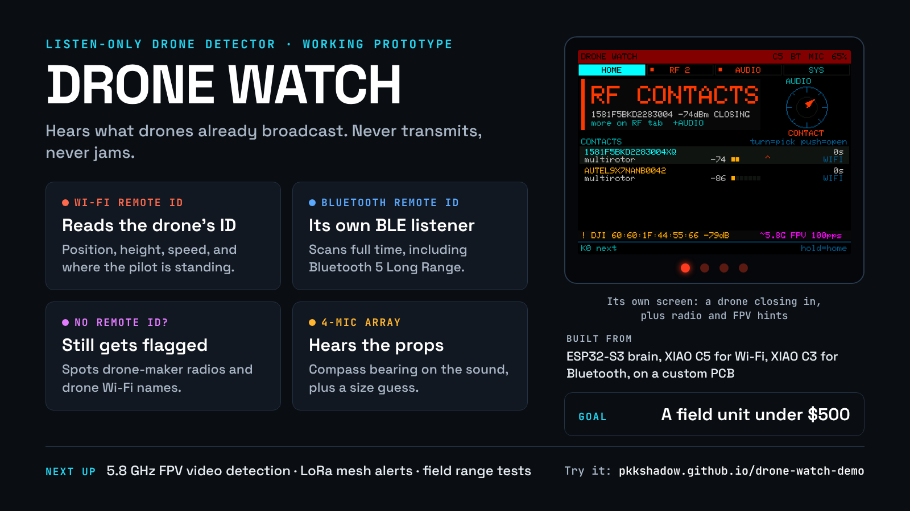
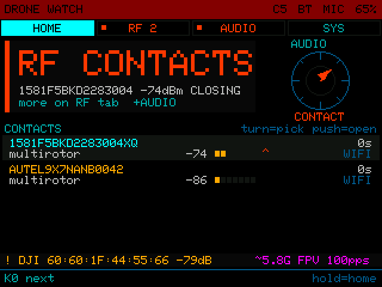

# DRONE WATCH field simulator

**[Open the live demo](https://pkkshadow.github.io/drone-watch-demo/)**

DRONE WATCH is a homemade, listen-only drone detector. It never transmits anything; it only picks up what drones already put in the air:

- **Remote ID over Wi-Fi.** Most drones in the US must broadcast an ID, a position and the pilot's location. The detector reads it from Wi-Fi beacon and NAN frames, on 2.4 and 5 GHz.
- **Remote ID over Bluetooth.** A separate small board listens for Bluetooth Remote ID full time, including Bluetooth 5 Long Range.
- **Drones without Remote ID.** It flags radios whose hardware address belongs to a drone maker, and Wi-Fi networks with a drone's name. These show as hints, not contacts.
- **FPV video hints.** It notices 5.8 GHz Wi-Fi-style video links that don't belong to a nearby router.
- **Sound.** Four microphones on a cross-shaped arm hear propeller hum and give the direction it comes from.

This demo runs the device's real firmware in your browser. The ESP32-S3 main board and the XIAO ESP32-C5 radio scanner are compiled to WebAssembly. A simulated field of drones, Wi-Fi traffic, wind and noise surrounds them.

## Where the project is now

*Updated November 21, 2026.*

**Working on the real device:**

- Three boards share the work:
  - an ESP32-S3 main board runs the screen, lights, buzzer and microphones;
  - a XIAO ESP32-C5 listens to Wi-Fi;
  - a XIAO ESP32-C3 listens to Bluetooth.
- Remote ID over Wi-Fi (beacon and NAN) and over Bluetooth (Bluetooth 4 and Bluetooth 5 Long Range), merged into one contact list.
- A bigger list of drone-maker hardware addresses, checked against the official IEEE registry, plus matching on drone Wi-Fi network names.
- The four-microphone array, with a compass bearing and a size guess.
- A "closing" alert when a drone's signal keeps getting stronger.
- A custom carrier circuit board, and a shielded enclosure so the electronics don't drown out the radios.

**In this browser demo:** the November 4 firmware (S3 v26, C5 v3). It doesn't have the Bluetooth board or network-name matching yet, so the **BT** badge stays grey.

**Next up:**

1. **5.8 GHz FPV video detection.** Most FPV drones send analog or DJI digital video that a Wi-Fi radio can't see. A dedicated 5.8 GHz receiver and a custom band-pass filter board are planned for this.
2. **Mesh warnings.** A version that sends its alerts over LoRa into a Meshtastic mesh, so remote solar-powered units can warn people further away.
3. **Real-world range tests** against actual drones, with the results published here.

**Goal:** a field unit that costs under $500 to build.

## Help fund it

This is built and paid for by one person. If you'd like to help with parts, boards or test equipment, any amount helps. Reach out on X: [@Cephalon_Shade](https://x.com/Cephalon_Shade).

## Using the demo

1. Pick a scenario from **Load a scenario**, or add drones with the colored buttons above the map.
2. Watch the unit on the left. Its screen, its four lights and its buzzer react as drones come into range. Turn your sound on to hear the buzzer.
3. Click a drone on the map to select it, then click anywhere on the map to send it there. You can also use **fly at me**, **orbit me** or **fly away**.
4. Click the unit's screen, then:
   - **Space** is the K0 button: next screen, or hold for HOME.
   - The **arrow keys** turn the knob.
   - **Enter** pushes the knob: open a contact, or push twice on AUDIO to start the array check.
5. Change wind, background noise, phones nearby, the neighbor's router and an air conditioner. Each one affects what the detector picks up.

It works on a phone too.

## How the real device works

The **[user guide](GUIDE.md)** covers:

- Drones 101, for people who have never flown one
- Setting up outdoors and the microphone array check
- Every screen, light and sound
- What to do (and not do) when a drone shows up
- What the detector can't see, and troubleshooting

## How realistic is it?

**Real:**
- The firmware.
- Everything on the screen, the light patterns, the buzzer and the serial output come from the same code that runs on the hardware.

**Modeled:**
- **Remote ID and other Wi-Fi frames:** path loss, random fading and a receiver sensitivity limit. A frame only reaches the scanner if it is tuned to that channel at that moment.
- **Sound for each microphone, sample by sample:**
  - propeller harmonics with Doppler and RPM wobble, and prop noise;
  - wind gusts, an air conditioner and hand claps;
  - each sound arriving with its true delay at each microphone.

**Not exact:**
- Detection ranges depend on these models.
- Treat them as a guide, not a promise for any particular site.

The map location is a field in central Kansas, chosen for the demo.
